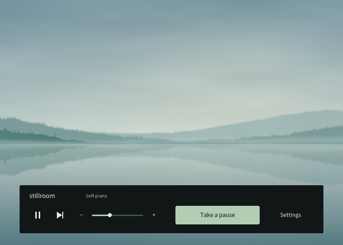
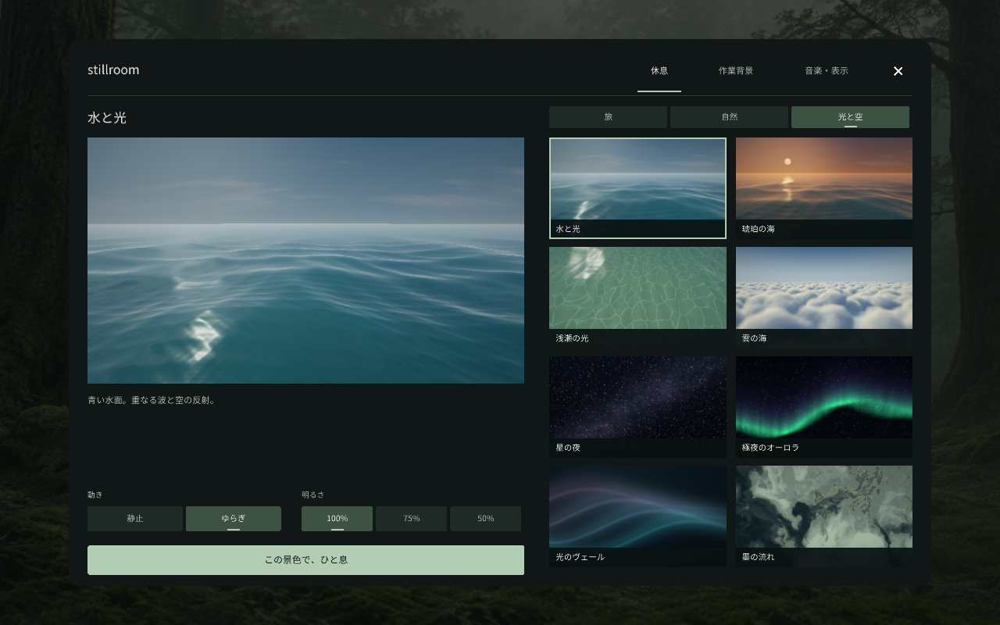
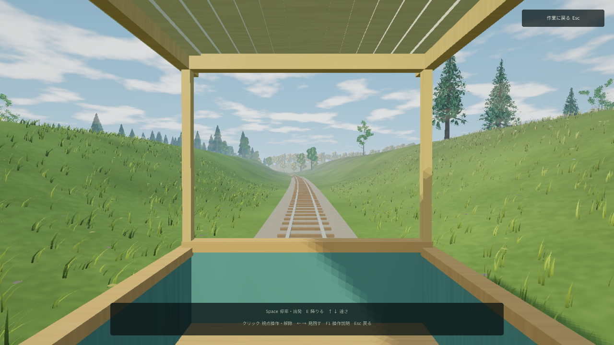

# Stillroom

A small Windows listening room, written in Haskell. Open it and music starts;
leave it alone and the controls disappear into a quiet, static screen.

[Download for Windows](https://github.com/M-simplifier/stillroom/releases/latest)
· [Website](https://m-simplifier.github.io/stillroom/)
· [Developer notes](https://m-simplifier.github.io/stillroom/developers.html)
· [Guide](docs/guide.md) · [休息モードの使い方](docs/rest-mode.md)
· [Architecture](docs/architecture.md) · [Graphics foundation](docs/graphics-foundation.md) · [Performance](docs/performance.md)
· [Interface design](docs/design.md)
· [Procedural landscapes](docs/procedural-landscapes.md) · [The quiet line](docs/journeys.md)



- Four gently evolving built-in scores: soft piano, warm keys, quiet pulse and
  wood & air. No account or additional downloads; choose a mood and let it continue.
- Or choose a folder of your own MP3, WAV or OGG files.
- Shuffle without immediate repeats when at least two playable tracks exist.
- Your own finite tracks blend with equal-power crossfades. Built-in music has no timed ending.
- Static green, slate, black or illustrated lake backgrounds while working.
- Ten quiet image backgrounds, including four landscapes generated from code,
  or import your own PNG, JPEG or BMP. Choose
  an image and its brightness; neither track changes nor time switch it for you.
- Choose from eleven procedural rest scenes in a thumbnail gallery with a live
  preview: three landscapes with trees, grass and water, plus eight scenes of
  water, sunset, shallows, clouds, aurora, ink, light and stars. Set motion and
  brightness before resting. Scenery is generated locally from geometry and
  shaders, without landscape image, model or video assets.
- A continuous journey through six procedural habitats: ride an observation
  railcar, stop and step onto safe ground, walk freely or enable automatic walking.
  Your seed and place are saved between breaks and launches. New landscapes are
  an explicit choice in Settings → Rest → Journey.
- Wind, leaves, nearby water and the moving railcar accompany the journey.
  Music becomes quieter during the ride and returns when you resume work.
  Turn journey sounds off in Rest settings if you prefer music alone.
- Click the background or press **R** to rest. **Esc/R** returns to work immediately.
  The eleven quiet scenes also leave on click; the journey uses click to look
  around and has a visible return button. Music continues throughout.
- Three clear settings pages, a large scene preview, direct motion/brightness
  choices, and keyboard focus navigation with Tab, Shift-Tab and Enter.
- Rest graphics adapt to the rendering load, with fixed Low through Ultra
  choices for water, light, shadows and detail. See [graphics quality](docs/graphics-quality.md).
- A native app icon for Explorer, shortcuts and the taskbar.
- Choose a display; use fullscreen or a small window. Settings persist.
- English and Japanese controls. No network requests, analytics or updater.

Extract the ZIP and open **stillroom.exe**. No Haskell toolchain or .NET installation
is needed to use the Windows binary. The executable is unsigned.





[Watch the journey on the website](https://m-simplifier.github.io/stillroom/#journey)

## A functional core

`step :: Event -> Session -> (Session, [Effect])` describes state changes without
performing them. Validated volume/time values, seeded shuffle, crossfade curves,
and sample-based composition are ordinary pure functions. A small imperative
boundary owns the window, two audio decks, native handles and preferences.
See the [architecture](docs/architecture.md) for the ownership rules.

## Build

On Windows x64, install GHC **9.6.7**, Cabal **3.12.1.0** and GHCup's MSYS2 tools:

```powershell
./tools/dev.ps1 Build -Online  # First build: fetch pinned dependencies
./tools/dev.ps1 Capture       # Incremental build + 28 UI/landscape/journey screenshots
```

The entrypoint finds the pinned tools, sets up GMP and development assets, then
restores the caller's environment. Later runs are offline by default. Full logs
and a JSON summary go to a fresh folder under `scratch/dev`; the console prints
the result, commit, executable hash and report path. The first native dependency
build can take several minutes. Native checks need real graphics/audio devices:

```powershell
./tools/dev.ps1 Check
./tools/dev.ps1 CheckPackage -Executable C:/path/to/extracted/stillroom.exe
```

Package checks require the extracted application's own assets and DLL; they
cannot fall back to development assets. See [development commands and check
selection](docs/development.md), including packaging and renderer benchmarks.
See [GMP distribution](docs/gmp.md) for library source and notices.

## Scope and license

This is an early **Windows-only** utility. It makes no clinical or measured
productivity claims. See [status and verification limits](STATUS.md).

Code, original synthesis and original scenery are **MIT** licensed. Dependencies
retain their licenses; the font is **SIL OFL 1.1** and the processed Salamander
piano recordings are **CC BY 3.0**. No Suno recordings are
distributed. User music retains its original rights and is never uploaded.
See [music licensing](docs/music-licensing.md), [asset provenance](docs/assets.md),
and [third-party notices](licenses/README.md).

Ideas and bug reports are welcome through issues. Read
[CONTRIBUTING.md](CONTRIBUTING.md) before starting a substantial pull request.
